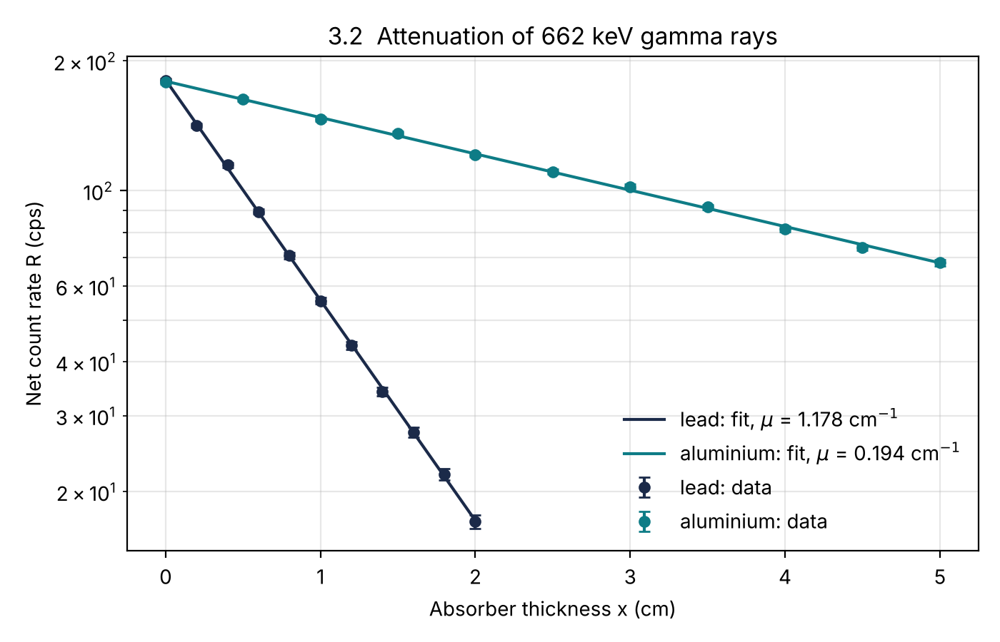

# Activity 3.2 – Gamma-ray attenuation: how good is a shield?

*Radiation Detection Activity Book*, Chapter 3 (Scintillation Counter unit), Section 3.2.
Instrument: Scintillation Counter unit.

| File | What it is |
|---|---|
| `gamma_attenuation.py` | the analysis script |
| `attenuation.csv` | example data (23 rows, simulated) |
| `expected_output/` | what you should see: `output.txt` and `attenuation.png` |

## How to run it
1. Download the files of this folder (or the whole repository, see the [main page](https://github.com/Detectors4Education/radiation-activity-book)).
   Keep the script and its CSV file(s) **in the same folder**.
2. Open `gamma_attenuation.py` in **Thonny** (or any Python editor) and press **Run** (F5).
   Or, in a terminal opened in this folder: `python gamma_attenuation.py`
3. The results are printed, and the graph is saved as `attenuation.png` next to the script.

## Use your own measurements
Make a CSV file with exactly the same column names (first line below) and save it in this folder. Then either
replace the example file (keep its name), or type its name after the script name:
`python gamma_attenuation.py my_data.csv`

Columns (first line of the file):
- `attenuation.csv`: `material,thickness_mm,counts,time_s`

Lines that start with `#` are notes; the script skips them.

## Expected output (example data)
```
First rows of the data table:
     material  thickness_mm  counts  time_s
0  background             0    1164     300
1        lead             0   11030      60
2        lead             2    8730      60
3        lead             4    7107      60
4        lead             6    5593      60 

Background rate: 3.880 +/- 0.114 cps

=== LEAD ===
  mu      = 1.178 +/- 0.009 cm^-1
  mu/rho  = 0.1038 +/- 0.0008 cm^2/g (NIST narrow-beam value 0.111 cm^2/g)
  HVL     = 0.588 +/- 0.004 cm
  chi^2/ndf = 3.3/9 = 0.37

=== ALUMINIUM ===
  mu      = 0.194 +/- 0.002 cm^-1
  mu/rho  = 0.0719 +/- 0.0009 cm^2/g (NIST narrow-beam value 0.0748 cm^2/g)
  HVL     = 3.568 +/- 0.044 cm
  chi^2/ndf = 6.3/9 = 0.70

Graph saved to attenuation.png (next to this script)
```


[← All activities](https://github.com/Detectors4Education/radiation-activity-book)
