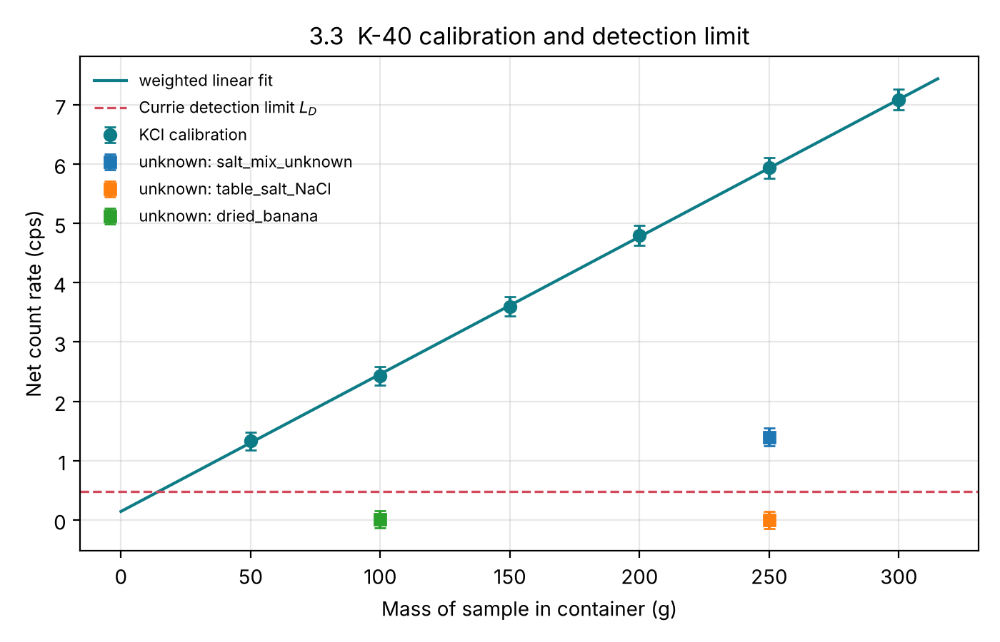

# Activity 3.3 – Natural radioactivity: potassium-40 and detection limits

*Radiation Detection Activity Book*, Chapter 3 (Scintillation Counter unit), Section 3.3.
Instrument: Scintillation Counter unit.

| File | What it is |
|---|---|
| `potassium_detection_limit.py` | the analysis script |
| `potassium.csv` | example data (10 rows, simulated) |
| `expected_output/` | what you should see: `output.txt` and `potassium.png` |

## How to run it
1. Download the files of this folder (or the whole repository, see the [main page](https://github.com/Detectors4Education/radiation-activity-book)).
   Keep the script and its CSV file(s) **in the same folder**.
2. Open `potassium_detection_limit.py` in **Thonny** (or any Python editor) and press **Run** (F5).
   Or, in a terminal opened in this folder: `python potassium_detection_limit.py`
3. The results are printed, and the graph is saved as `potassium.png` next to the script.

## Use your own measurements
Make a CSV file with exactly the same column names (first line below) and save it in this folder. Then either
replace the example file (keep its name), or type its name after the script name:
`python potassium_detection_limit.py my_data.csv`

Columns (first line of the file):
- `potassium.csv`: `sample,mass_g,counts,time_s`

Lines that start with `#` are notes; the script skips them.

## Expected output (example data)
```
Theory: specific activity of KCl = 16.6 Bq/g

Background: 6.120 +/- 0.101 cps  (3672 counts in 600 s)
Currie decision threshold L_C = 141 counts = 0.235 cps net
Currie detection limit    L_D = 284 counts = 0.474 cps net

Calibration: net rate = (23.17 +/- 0.79) x 10^-3 cps/g * m + (0.142 +/- 0.146) cps
Overall detection efficiency = 0.139 % of K-40 decays

Smallest detectable mass of KCl (this geometry) ~ 14 g

sample                  net rate (cps)  detected?    KCl-equiv. (g)  KCl fraction
salt_mix_unknown        1.397 +/- 0.151      yes         54 +/- 7            22 %
table_salt_NaCl         0.000 +/- 0.143       no       < 14               < 6 %
dried_banana            0.008 +/- 0.143       no       < 14              < 14 %

Graph saved to potassium.png (next to this script)
```


[← All activities](https://github.com/Detectors4Education/radiation-activity-book)
