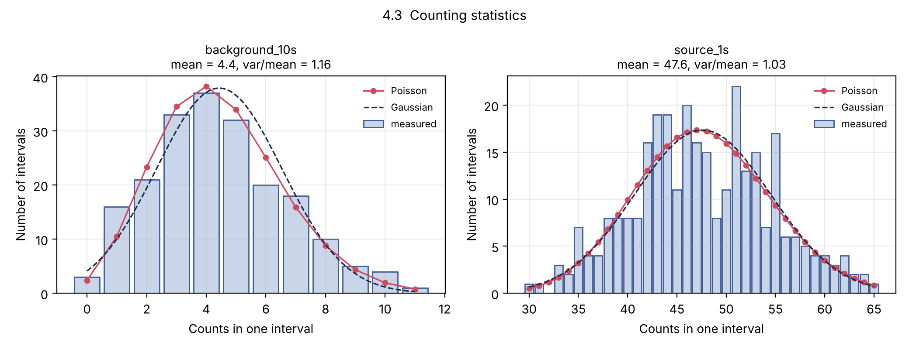

# Activity 4.3 – The statistics of counting: Poisson and Gaussian

*Radiation Detection Activity Book*, Chapter 4 (Geiger-Müller Counter unit), Section 4.3.
Instrument: Geiger-Müller Counter unit.

| File | What it is |
|---|---|
| `counting_statistics.py` | the analysis script |
| `background_10s.csv` | example data (200 rows, simulated) |
| `source_1s.csv` | example data (300 rows, simulated) |
| `expected_output/` | what you should see: `output.txt` and `statistics.png` |

## How to run it
1. Download the files of this folder (or the whole repository, see the [main page](https://github.com/Detectors4Education/radiation-activity-book)).
   Keep the script and its CSV file(s) **in the same folder**.
2. Open `counting_statistics.py` in **Thonny** (or any Python editor) and press **Run** (F5).
   Or, in a terminal opened in this folder: `python counting_statistics.py`
3. The results are printed, and the graph is saved as `statistics.png` next to the script.

## Use your own measurements
Make a CSV file with exactly the same column names (first line below) and save it in this folder. Then either
replace the example file (keep its name), or type its name after the script name:
`python counting_statistics.py my_data.csv`

Columns (first line of the file):
- `background_10s.csv`: `interval,counts`
- `source_1s.csv`: `interval,counts`

Lines that start with `#` are notes; the script skips them.

## Expected output (example data)
```
=== background_10s.csv ===
  number of intervals N = 200
  mean  = 4.43 +/- 0.16 counts per interval
  variance = 5.14   ->  variance/mean = 1.16 (Poisson predicts 1.00)
  standard deviation = 2.27;  sqrt(mean) = 2.11
  chi^2 = 6.0 for 7 degrees of freedom, p-value = 0.53
  -> consistent with Poisson (p > 0.05)

=== source_1s.csv ===
  number of intervals N = 300
  mean  = 47.61 +/- 0.40 counts per interval
  variance = 49.06   ->  variance/mean = 1.03 (Poisson predicts 1.00)
  standard deviation = 7.00;  sqrt(mean) = 6.90
  chi^2 = 28.9 for 24 degrees of freedom, p-value = 0.22
  -> consistent with Poisson (p > 0.05)

Graph saved to statistics.png (next to this script)
```


[← All activities](https://github.com/Detectors4Education/radiation-activity-book)
