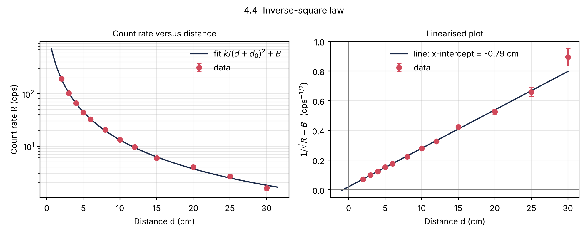

# Activity 4.4 – How does radiation spread out? The inverse-square law

*Radiation Detection Activity Book*, Chapter 4 (Geiger-Müller Counter unit), Section 4.4.
Instrument: Geiger-Müller Counter unit.

| File | What it is |
|---|---|
| `inverse_square.py` | the analysis script |
| `inverse_square.csv` | example data (12 rows, simulated) |
| `expected_output/` | what you should see: `output.txt` and `inverse_square.png` |

## How to run it
1. Download the files of this folder (or the whole repository, see the [main page](https://github.com/Detectors4Education/radiation-activity-book)).
   Keep the script and its CSV file(s) **in the same folder**.
2. Open `inverse_square.py` in **Thonny** (or any Python editor) and press **Run** (F5).
   Or, in a terminal opened in this folder: `python inverse_square.py`
3. The results are printed, and the graph is saved as `inverse_square.png` next to the script.

## Use your own measurements
Make a CSV file with exactly the same column names (first line below) and save it in this folder. Then either
replace the example file (keep its name), or type its name after the script name:
`python inverse_square.py my_data.csv`

Columns (first line of the file):
- `inverse_square.csv`: `distance_cm,counts,time_s`

Lines that start with `#` are notes; the script skips them.

## Expected output (example data)
```
Linear method  (1/sqrt(R-B) versus d)
  k  = 1492 cps cm^2,   d0 = 0.79 cm

Non-linear fit  R = k/(d+d0)^2 + B
  k (cps cm^2)  =  1507.179 +/- 33.684
  d0 (cm)       =     0.804 +/- 0.039
  B (cps)       =     0.213 +/- 0.129
  chi^2/ndf = 10.4/9

Free exponent fit: n = 2.017 +/- 0.047  (expected 2)

Graph saved to inverse_square.png (next to this script)
```


[← All activities](https://github.com/Detectors4Education/radiation-activity-book)
