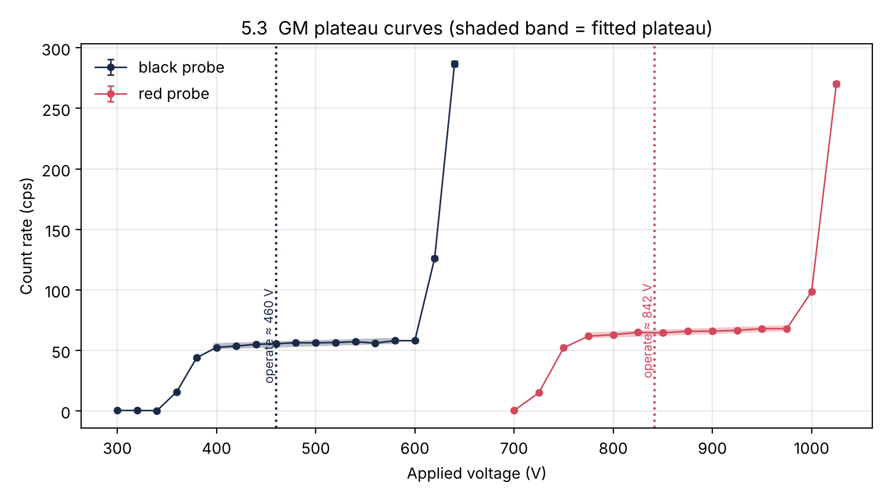

# Activity 5.3 – Finding the operating voltage: the GM plateau

*Radiation Detection Activity Book*, Chapter 5 (Universal Radiometer + GM Tube Probes), Section 5.3.
Instrument: Universal Radiometer + GM Tube Probes.

| File | What it is |
|---|---|
| `gm_plateau.py` | the analysis script |
| `plateau.csv` | example data (32 rows, simulated) |
| `expected_output/` | what you should see: `output.txt` and `plateau.png` |

## How to run it
1. Download the files of this folder (or the whole repository, see the [main page](https://github.com/Detectors4Education/radiation-activity-book)).
   Keep the script and its CSV file(s) **in the same folder**.
2. Open `gm_plateau.py` in **Thonny** (or any Python editor) and press **Run** (F5).
   Or, in a terminal opened in this folder: `python gm_plateau.py`
3. The results are printed, and the graph is saved as `plateau.png` next to the script.

## Use your own measurements
Make a CSV file with exactly the same column names (first line below) and save it in this folder. Then either
replace the example file (keep its name), or type its name after the script name:
`python gm_plateau.py my_data.csv`

Columns (first line of the file):
- `plateau.csv`: `probe,voltage_V,counts,time_s`

Lines that start with `#` are notes; the script skips them.

## Expected output (example data)
```
=== black probe ===
  starting voltage        ~ 360 V
  plateau used            : 400-580 V  (length 180 V)
  plateau count rate      ~ 55.7 cps
  plateau slope           = 4.4 +/- 0.9 % per 100 V
  suggested operating V   ~ 460 V

=== red probe ===
  starting voltage        ~ 725 V
  plateau used            : 775-975 V  (length 200 V)
  plateau count rate      ~ 65.4 cps
  plateau slope           = 4.6 +/- 0.8 % per 100 V
  suggested operating V   ~ 842 V

Graph saved to plateau.png (next to this script)
```


[← All activities](https://github.com/Detectors4Education/radiation-activity-book)
