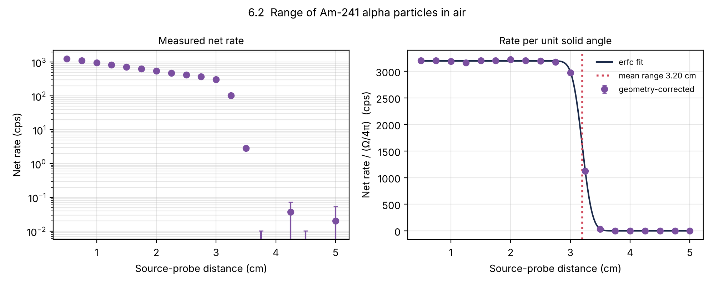

# Activity 6.2 – How far do alpha particles go? Range in air

*Radiation Detection Activity Book*, Chapter 6 (Universal Radiometer + Scintillation Probe), Section 6.2.
Instrument: Universal Radiometer + Scintillation Probe.

| File | What it is |
|---|---|
| `alpha_range.py` | the analysis script |
| `alpha_range.csv` | example data (20 rows, simulated) |
| `expected_output/` | what you should see: `output.txt` and `alpha_range.png` |

## How to run it
1. Download the files of this folder (or the whole repository, see the [main page](https://github.com/Detectors4Education/radiation-activity-book)).
   Keep the script and its CSV file(s) **in the same folder**.
2. Open `alpha_range.py` in **Thonny** (or any Python editor) and press **Run** (F5).
   Or, in a terminal opened in this folder: `python alpha_range.py`
3. The results are printed, and the graph is saved as `alpha_range.png` next to the script.

## Use your own measurements
Make a CSV file with exactly the same column names (first line below) and save it in this folder. Then either
replace the example file (keep its name), or type its name after the script name:
`python alpha_range.py my_data.csv`

Columns (first line of the file):
- `alpha_range.csv`: `source,distance_cm,counts,time_s`

Lines that start with `#` are notes; the script skips them.

## Expected output (example data)
```
Mean range in lab air  R_m   = 3.200 +/- 0.002 cm
Straggling width       sigma = 0.132 +/- 0.002 cm
Extrapolated range     R_e   = R_m + sqrt(pi/2)*sigma = 3.36 cm
Range in standard air (15 C, 101.325 kPa) = 3.12 cm
Alpha energy from Geiger's rule           = 4.59 MeV
Reference: Am-241 emits 5.486 MeV alphas (range ~4.1 cm in standard air)
-> energy apparently lost before leaving the source ~ 0.9 MeV

Graph saved to alpha_range.png (next to this script)
```


[← All activities](https://github.com/Detectors4Education/radiation-activity-book)
