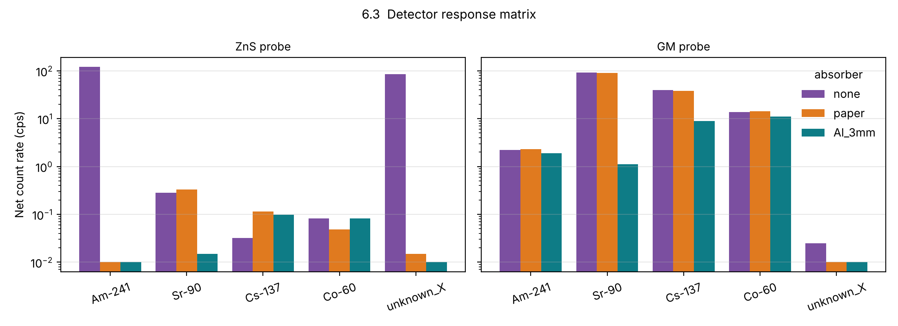

# Activity 6.3 – Who sees what? Identifying radiation with two probes and two absorbers

*Radiation Detection Activity Book*, Chapter 6 (Universal Radiometer + Scintillation Probe), Section 6.3.
Instrument: Universal Radiometer + Scintillation Probe.

| File | What it is |
|---|---|
| `response_matrix.py` | the analysis script |
| `response_matrix.csv` | example data (32 rows, simulated) |
| `expected_output/` | what you should see: `output.txt` and `response.png` |

## How to run it
1. Download the files of this folder (or the whole repository, see the [main page](https://github.com/Detectors4Education/radiation-activity-book)).
   Keep the script and its CSV file(s) **in the same folder**.
2. Open `response_matrix.py` in **Thonny** (or any Python editor) and press **Run** (F5).
   Or, in a terminal opened in this folder: `python response_matrix.py`
3. The results are printed, and the graph is saved as `response.png` next to the script.

## Use your own measurements
Make a CSV file with exactly the same column names (first line below) and save it in this folder. Then either
replace the example file (keep its name), or type its name after the script name:
`python response_matrix.py my_data.csv`

Columns (first line of the file):
- `response_matrix.csv`: `detector,source,absorber,counts,time_s`

Lines that start with `#` are notes; the script skips them.

## Expected output (example data)
```
source     det.     none (cps)  paper/none   Al/none
Am-241     GM       2.23+/-0.21       1.03      0.84
Am-241     ZnS    120.03+/-1.41      -0.00     -0.00
Co-60      GM      13.68+/-0.49       1.04      0.81
Co-60      ZnS      0.08+/-0.05          -         -
Cs-137     GM      39.98+/-0.82       0.94      0.22
Cs-137     ZnS      0.03+/-0.04          -         -
Sr-90      GM      92.12+/-1.24       0.98      0.01
Sr-90      ZnS      0.28+/-0.08       1.18      0.05
unknown_X  GM       0.03+/-0.09          -         -
unknown_X  ZnS     85.45+/-1.19       0.00     -0.00

Identification:
  Am-241      -> alpha, gamma
  Sr-90       -> beta
  Cs-137      -> beta, gamma
  Co-60       -> gamma
  unknown_X   -> alpha

Graph saved to response.png (next to this script)
```


[← All activities](https://github.com/Detectors4Education/radiation-activity-book)
