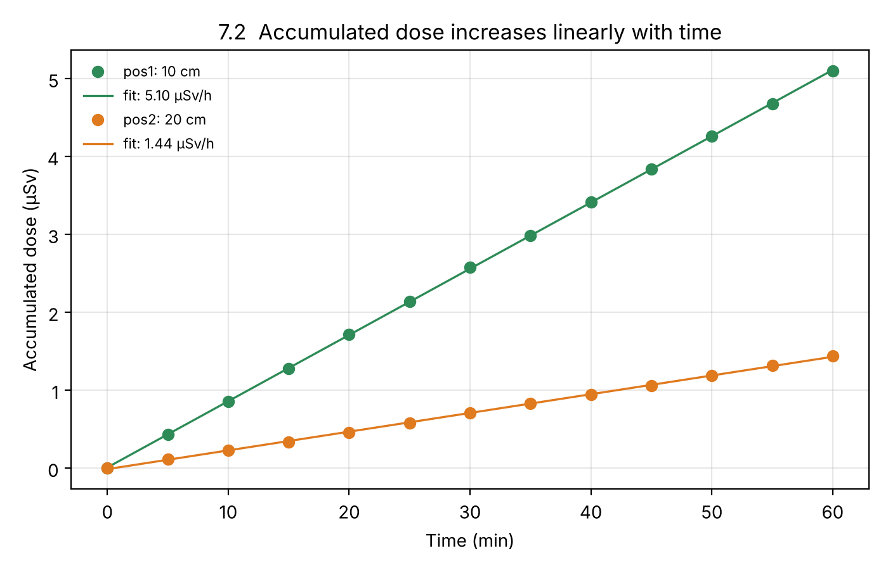

# Activity 7.2 – Speedometer and odometer: dose versus dose rate

*Radiation Detection Activity Book*, Chapter 7 (Personal Dosimeter), Section 7.2.
Instrument: Personal Dosimeter.

| File | What it is |
|---|---|
| `dose_vs_dose_rate.py` | the analysis script |
| `dose_vs_time.csv` | example data (13 rows, simulated) |
| `expected_output/` | what you should see: `output.txt` and `dose.png` |

## How to run it
1. Download the files of this folder (or the whole repository, see the [main page](https://github.com/Detectors4Education/radiation-activity-book)).
   Keep the script and its CSV file(s) **in the same folder**.
2. Open `dose_vs_dose_rate.py` in **Thonny** (or any Python editor) and press **Run** (F5).
   Or, in a terminal opened in this folder: `python dose_vs_dose_rate.py`
3. The results are printed, and the graph is saved as `dose.png` next to the script.

## Use your own measurements
Make a CSV file with exactly the same column names (first line below) and save it in this folder. Then either
replace the example file (keep its name), or type its name after the script name:
`python dose_vs_dose_rate.py my_data.csv`

Columns (first line of the file):
- `dose_vs_time.csv`: `time_min,dose_uSv_pos1,rate_uSvh_pos1,dose_uSv_pos2,rate_uSvh_pos2`

Lines that start with `#` are notes; the script skips them.

## Expected output (example data)
```
=== pos1 (10 cm) ===
  gradient of D(t)      = 5.10 +/- 0.01 uSv/h
  mean displayed rate   = 5.06 +/- 0.11 uSv/h
  difference            = 0.4 combined standard uncertainties

=== pos2 (20 cm) ===
  gradient of D(t)      = 1.44 +/- 0.01 uSv/h
  mean displayed rate   = 1.42 +/- 0.04 uSv/h
  difference            = 0.4 combined standard uncertainties

Dose-rate ratio pos1/pos2 = 3.54; inverse-square law predicts 4.00
(Real sources and detectors are not points, so expect some difference.)

Graph saved to dose.png (next to this script)
```


[← All activities](https://github.com/Detectors4Education/radiation-activity-book)
