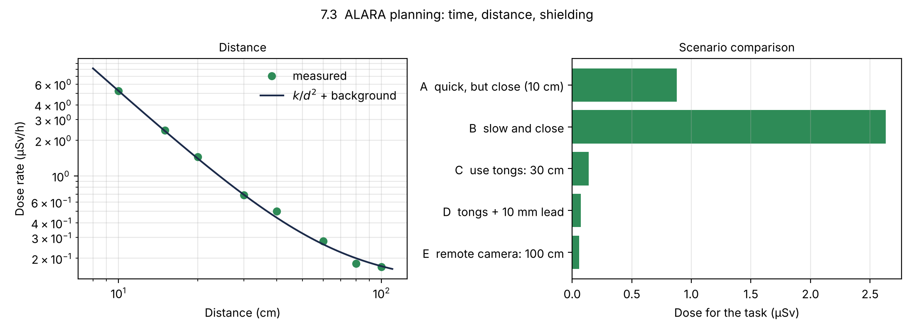

# Activity 7.3 – Time, distance, shielding: planning a task with ALARA

*Radiation Detection Activity Book*, Chapter 7 (Personal Dosimeter), Section 7.3.
Instrument: Personal Dosimeter.

| File | What it is |
|---|---|
| `alara_planner.py` | the analysis script |
| `dose_rates.csv` | example data (16 rows, simulated) |
| `expected_output/` | what you should see: `output.txt` and `alara.png` |

## How to run it
1. Download the files of this folder (or the whole repository, see the [main page](https://github.com/Detectors4Education/radiation-activity-book)).
   Keep the script and its CSV file(s) **in the same folder**.
2. Open `alara_planner.py` in **Thonny** (or any Python editor) and press **Run** (F5).
   Or, in a terminal opened in this folder: `python alara_planner.py`
3. The results are printed, and the graph is saved as `alara.png` next to the script.

## Use your own measurements
Make a CSV file with exactly the same column names (first line below) and save it in this folder. Then either
replace the example file (keep its name), or type its name after the script name:
`python alara_planner.py my_data.csv`

Columns (first line of the file):
- `dose_rates.csv`: `series,distance_cm,lead_mm,dose_rate_uSvh`

Lines that start with `#` are notes; the script skips them.

## Expected output (example data)
```
Distance model:  D_dot = 514/d^2 + 0.12 uSv/h   (d in cm)
Shield model at 20 cm: D_dot = 1.32 exp(-0.120 x) + 0.12  (x in mm)
  -> half-value layer of lead = 5.8 mm

scenario                           rate (uSv/h)  dose (uSv)  % of 1 mSv
A  quick, but close (10 cm)                5.26       0.877     0.0877 %
B  slow and close                          5.26       2.632     0.2632 %
C  use tongs: 30 cm                        0.69       0.138     0.0138 %
D  tongs + 10 mm lead                      0.29       0.073     0.0073 %
E  remote camera: 100 cm                   0.17       0.057     0.0057 %

Lowest-dose plan: E  remote camera: 100 cm
Remember: background alone gives about the same dose rate everywhere -
compare each plan with doing nothing for the same time!

Graph saved to alara.png (next to this script)
```


[← All activities](https://github.com/Detectors4Education/radiation-activity-book)
