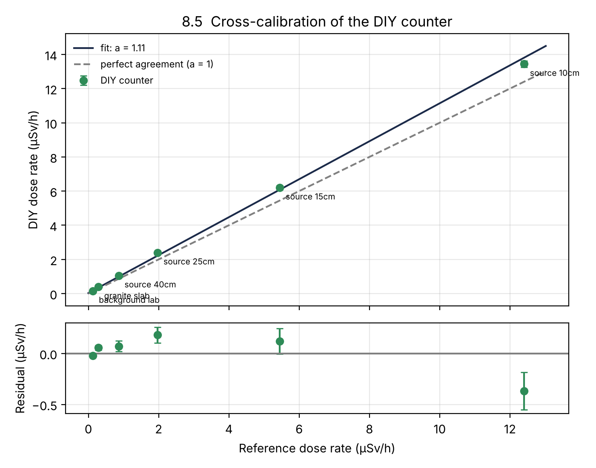

# Activity 8.5 – Build it, check it, trust it: assembly, commissioning and calibration

*Radiation Detection Activity Book*, Chapter 8 (DIY Geiger-Müller Set), Section 8.5.
Instrument: DIY Geiger-Müller Set (GC DIY 4 EDU).

| File | What it is |
|---|---|
| `cross_calibration.py` | the analysis script |
| `cross_calibration.csv` | example data (6 rows, simulated) |
| `expected_output/` | what you should see: `output.txt` and `calibration.png` |

## How to run it
1. Download the files of this folder (or the whole repository, see the [main page](https://github.com/Detectors4Education/radiation-activity-book)).
   Keep the script and its CSV file(s) **in the same folder**.
2. Open `cross_calibration.py` in **Thonny** (or any Python editor) and press **Run** (F5).
   Or, in a terminal opened in this folder: `python cross_calibration.py`
3. The results are printed, and the graph is saved as `calibration.png` next to the script.

## Use your own measurements
Make a CSV file with exactly the same column names (first line below) and save it in this folder. Then either
replace the example file (keep its name), or type its name after the script name:
`python cross_calibration.py my_data.csv`

Columns (first line of the file):
- `cross_calibration.csv`: `position,reference_uSvh,diy_dose_uSv,time_s`

Lines that start with `#` are notes; the script skips them.

## Expected output (example data)
```
Calibration ratio  a = 1.111 +/- 0.012   (a perfect counter gives 1)
Offset             c = 0.029 +/- 0.010 uSv/h
chi^2/ndf = 22.3/4
Note: the reference dose rates also have uncertainties, so chi^2 may be large.

Correction for your DIY counter:
   true dose rate (uSv/h) = (DIY reading - 0.029) / 1.111
   e.g. a DIY reading of 1.00 uSv/h  ->  0.87 uSv/h
Your tube is 11 % more sensitive than the display assumes.

Graph saved to calibration.png (next to this script)
```


[← All activities](https://github.com/Detectors4Education/radiation-activity-book)
