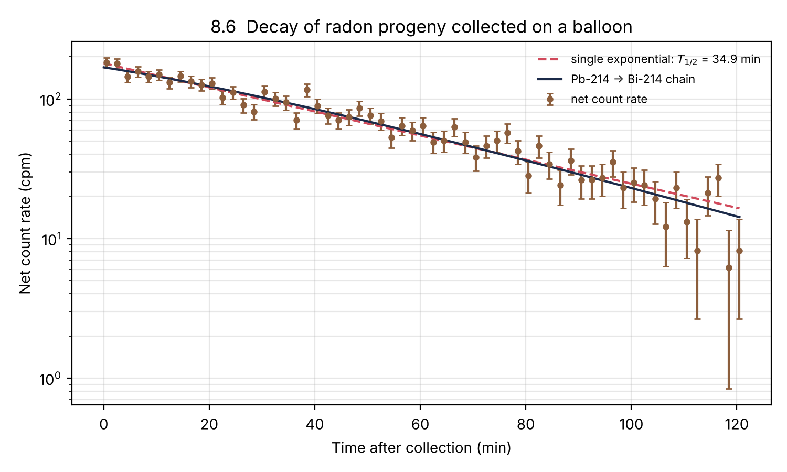

# Activity 8.6 – Catching radon daughters on a balloon: measuring a half-life

*Radiation Detection Activity Book*, Chapter 8 (DIY Geiger-Müller Set), Section 8.6.
Instrument: DIY Geiger-Müller Set (GC DIY 4 EDU).

| File | What it is |
|---|---|
| `radon_progeny.py` | the analysis script |
| `radon_progeny.csv` | example data (61 rows, simulated) |
| `expected_output/` | what you should see: `output.txt` and `radon.png` |

## How to run it
1. Download the files of this folder (or the whole repository, see the [main page](https://github.com/Detectors4Education/radiation-activity-book)).
   Keep the script and its CSV file(s) **in the same folder**.
2. Open `radon_progeny.py` in **Thonny** (or any Python editor) and press **Run** (F5).
   Or, in a terminal opened in this folder: `python radon_progeny.py`
3. The results are printed, and the graph is saved as `radon.png` next to the script.

## Use your own measurements
Make a CSV file with exactly the same column names (first line below) and save it in this folder. Then either
replace the example file (keep its name), or type its name after the script name:
`python radon_progeny.py my_data.csv`

Columns (first line of the file):
- `radon_progeny.csv`: `time_min,counts,time_s`

Lines that start with `#` are notes; the script skips them.

## Expected output (example data)
```
Background = 21.8 cpm

LEVEL 1  apparent half-life = 34.9 +/- 1.1 min (chi^2/ndf = 66/59)
LEVEL 2  N(Pb-214, t=0) = 3159 +/- 165,  N(Bi-214, t=0) = 2486 +/- 269  (x efficiency)
         ratio Bi/Pb at t=0 = 0.79   chi^2/ndf = 63/59

Graph saved to radon.png (next to this script)
```


[← All activities](https://github.com/Detectors4Education/radiation-activity-book)
