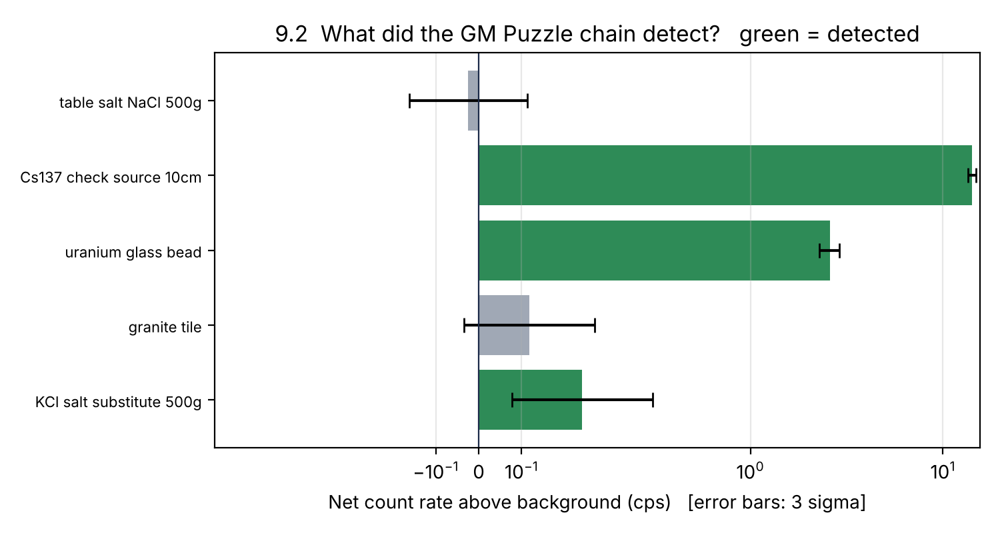

# Activity 9.2 – Build the measurement chain: what does each piece do?

*Radiation Detection Activity Book*, Chapter 9 (GM Puzzle Set), Section 9.2.
Instrument: GM Puzzle Set.

| File | What it is |
|---|---|
| `puzzle_detection.py` | the analysis script |
| `puzzle_samples.csv` | example data (6 rows, simulated) |
| `expected_output/` | what you should see: `output.txt` and `detection.png` |

## How to run it
1. Download the files of this folder (or the whole repository, see the [main page](https://github.com/Detectors4Education/radiation-activity-book)).
   Keep the script and its CSV file(s) **in the same folder**.
2. Open `puzzle_detection.py` in **Thonny** (or any Python editor) and press **Run** (F5).
   Or, in a terminal opened in this folder: `python puzzle_detection.py`
3. The results are printed, and the graph is saved as `detection.png` next to the script.

## Use your own measurements
Make a CSV file with exactly the same column names (first line below) and save it in this folder. Then either
replace the example file (keep its name), or type its name after the script name:
`python puzzle_detection.py my_data.csv`

Columns (first line of the file):
- `puzzle_samples.csv`: `sample,counts,time_s`

Lines that start with `#` are notes; the script skips them.

## Expected output (example data)
```
Background: 0.442 +/- 0.027 cps  (26.5 cpm)

sample                           net rate (cps)      z  verdict    t needed for 3 sigma
KCl_salt_substitute_500g        0.242 +/- 0.055    4.4  DETECTED        173 s
granite_tile                    0.118 +/- 0.051    2.3  not seen        644 s
uranium_glass_bead              2.585 +/- 0.104   24.8  DETECTED          5 s
Cs137_check_source_10cm        14.158 +/- 0.222   63.7  DETECTED          1 s
table_salt_NaCl_500g           -0.025 +/- 0.046   -0.5  not seen   -

Graph saved to detection.png (next to this script)
```


[← All activities](https://github.com/Detectors4Education/radiation-activity-book)
