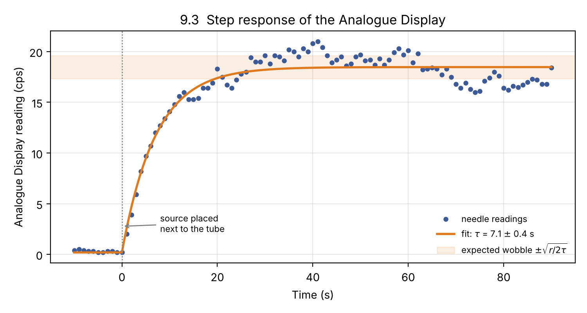

# Activity 9.3 – Digital or analogue? Precision and response time

*Radiation Detection Activity Book*, Chapter 9 (GM Puzzle Set), Section 9.3.
Instrument: GM Puzzle Set.

| File | What it is |
|---|---|
| `analogue_vs_digital.py` | the analysis script |
| `analogue_step.csv` | example data (101 rows, simulated) |
| `digital_repeats.csv` | example data (25 rows, simulated) |
| `expected_output/` | what you should see: `output.txt` and `analogue.png` |

## How to run it
1. Download the files of this folder (or the whole repository, see the [main page](https://github.com/Detectors4Education/radiation-activity-book)).
   Keep the script and its CSV file(s) **in the same folder**.
2. Open `analogue_vs_digital.py` in **Thonny** (or any Python editor) and press **Run** (F5).
   Or, in a terminal opened in this folder: `python analogue_vs_digital.py`
3. The results are printed, and the graph is saved as `analogue.png` next to the script.

## Use your own measurements
Make a CSV file with exactly the same column names (first line below) and save it in this folder. Then either
replace the example file (keep its name), or type its name after the script name:
`python analogue_vs_digital.py my_data.csv`

Columns (first line of the file):
- `analogue_step.csv`: `time_s,reading_cps`
- `digital_repeats.csv`: `gate_s,counts`

Lines that start with `#` are notes; the script skips them.

## Expected output (example data)
```
Before the source: r0  = 0.19 +/- 0.33 cps
Final reading:     r1  = 18.5 +/- 0.1 cps
Time constant:     tau = 7.1 +/- 0.4 s
Time to reach 95 % of the final value: 3*tau = 21 s

Analogue Display after settling: mean 18.4 cps, scatter 1.40 cps
   theory sqrt(r/(2 tau)) = 1.14 cps  -> relative 6.2 %
   (readings 1 s apart are NOT independent, so the measured
    scatter is only a rough check of the formula)

Digital Display, repeated measurements:
   gate   10 s: mean  18.42 cps, scatter  1.50 cps, Poisson predicts  1.36 cps  (7.4 %)
   gate  100 s: mean  18.83 cps, scatter  0.31 cps, Poisson predicts  0.43 cps  (2.3 %)

An analogue display with time constant tau is about as precise as a
digital count lasting 2*tau = 14 s, but it never 'finishes' a measurement.

Graph saved to analogue.png (next to this script)
```


[← All activities](https://github.com/Detectors4Education/radiation-activity-book)
